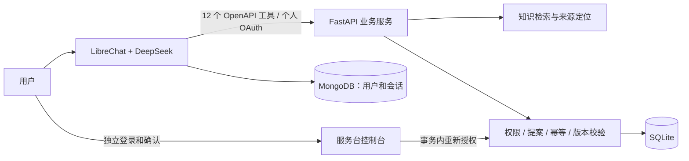

# 企业服务台 Agent：知识问答与工单协同

基于 [LibreChat](https://github.com/LibreChat-AI/LibreChat) 的业务扩展，面向 IT 服务台实现可追溯知识问答、工单处理、个人授权和评测运维。本项目复用 LibreChat 的聊天界面、Agent 执行循环与 Actions，自行实现独立的 Python 业务服务；不将上游框架功能计为原创成果。

**技术栈：** Python 3.12+ · FastAPI · SQLite · OpenAPI Actions · DeepSeek · BGE / RRF / Cross-Encoder · ONNX Runtime · OAuth 2.0 · Docker Compose

[启动与开发说明](extensions/support-agent/README.md) · [评测口径与结果](docs/support-agent/EVALUATION.md) · [知识库](extensions/support-agent/KNOWLEDGE.md) · [运行维护](extensions/support-agent/ops/README.md) · [上游原始 README](docs/support-agent/README.upstream.md)

## 项目能力与个人实现

| 能力 | 本项目新增实现 |
| --- | --- |
| 工单协同 | 创建草稿、分配负责人、记录处理过程、解决、关闭；状态转换校验与操作历史 |
| 执行控制 | 模型只生成提案，用户独立页面确认；事务内重新授权、幂等请求、版本冲突检测 |
| 多人使用 | 每人独立 OAuth 授权；员工、客服、管理员三类角色；组织及资源归属隔离 |
| 知识问答 | MD/TXT 幂等导入、分块和历史版本；文档/段落/行号来源定位；证据不足时追问或拒答 |
| 检索实验 | 词项与 BGE 向量召回、RRF 融合、Cross-Encoder 重排；量化 ONNX CPU 推理 |
| 评测与运维 | 回答、工具轨迹、数据库状态联合验收；费用记录、自动检查、健康监控、备份及隔离恢复 |

当前状态为**本地可运行的工程项目**：已验证工单闭环、角色限制、双用户身份隔离及备份恢复。业务演示资料是模拟资料；公开文档评测使用单独的 IBM Cloud 历史快照。企业统一登录、Jira 等外部工单平台、生产高可用与容量压测尚未接入或验收。

## 架构与执行边界



工单状态：`open → in_progress → resolved → closed`。员工仅访问本人工单，客服访问本人或分配给自己的工单，管理员访问本组织工单；只有提交人能关闭已解决工单。草稿和变更提案仅创建者可读、确认。工具凭证不能替代用户完成正式确认。

12 个工具包括：身份查询、知识检索、原文证据读取、工单列表/详情、草稿创建/查询、审计查询、可分配客服查询、处理历史查询、变更提案创建/查询。接口由 [OpenAPI 定义](extensions/support-agent/app/main.py) 和扩展路由生成。

## 在 Windows / VS Code 运行

准备 Git、Python 3.12 或更新版本、**PowerShell 7（`pwsh`）**、Docker Desktop（Linux containers / Compose v2）及 VS Code。模型对话调用 DeepSeek API，本机无需部署大语言模型；首次运行需联网下载依赖与镜像。当前自动化启动脚本针对 Windows，本地端口绑定 `127.0.0.1`。

在 PowerShell 中执行：

```powershell
git clone https://github.com/gsa-hash777/librechat-support-agent.git
cd librechat-support-agent
py -3.12 -m venv .venv
.\.venv\Scripts\python.exe extensions/support-agent/scripts/project.py Setup
```

`Setup` 安装 Python 依赖，生成随机的本地凭证和根目录 `.env`，保留已有配置。仅在本机编辑 `.env` 中的 `DEEPSEEK_API_KEY`。随后执行：

```powershell
.\.venv\Scripts\python.exe extensions/support-agent/scripts/project.py OperationsStart
.\.venv\Scripts\python.exe extensions/support-agent/scripts/project.py OpenApps
```

也可在 VS Code 打开 [SupportAgent.code-workspace](SupportAgent.code-workspace)，依次运行 `Support: Setup`、`Support: OperationsStart (OAuth + TLS, no model calls)`、`Support: OpenApps (system browser, no model calls)`。启动和初始化不调用付费模型；聊天与标记为 paid 的评测会调用模型。

首次启动准备本地 HTTPS 证书，Windows 可能要求将该证书加入当前用户信任。服务启动后，在同一系统浏览器配置文件中完成以下操作：

1. 打开 [LibreChat](http://localhost:3080)，使用本机 `.local/demo.json` 中的账号登录。
2. 选择“企业客服工单 Agent”，按提示连接服务台；在 [服务台控制台](https://localhost:8443/console) 使用本机 `.local/users.json` 中自己的业务账号授权。
3. 先查询有依据的业务问题，再创建工单草稿；打开确认链接，核对内容并确认创建。处理过程中分别以管理员、客服、提交人身份完成分配、处理、解决、关闭。

账号文件、API Key、证书私钥、数据库、备份和本地评测原始日志均不应上传。部署到其他主机需配置真实域名、可信 HTTPS 和准确 OAuth 回调，不能直接将本地演示配置公开到互联网。

## 多人、开发与检查

```powershell
# 准备独立 LibreChat 账号并共享同一个私有 Agent；每人仍需各自完成 OAuth
.\.venv\Scripts\python.exe extensions/support-agent/scripts/project.py MultiUser

# 自动测试；不调用付费模型
.\.venv\Scripts\python.exe extensions/support-agent/scripts/project.py Test

# 健康与指标检查、在线备份
.\.venv\Scripts\python.exe extensions/support-agent/scripts/project.py Monitor
.\.venv\Scripts\python.exe extensions/support-agent/scripts/project.py Backup

# 停止业务服务，保留持久化数据
.\.venv\Scripts\python.exe extensions/support-agent/scripts/project.py Stop
```

多人 LibreChat 登录资料生成在 `.local/librechat-users.json`，业务角色由服务端控制。普通启动不开启热重载；需要调试时运行 `Support: StartDebug`，使用工作区的 Docker attach 配置。此部署复用固定摘要的上游镜像，修改 Python 扩展可重启生效；修改上游 React/TypeScript 需另行安装前端依赖并构建。

可选 CPU 检索通过 `Support: Prepare CPU retrieval models`、`Support: Start with hybrid retrieval options` 准备。公开 IBM Cloud 资料在独立服务和索引中运行，参见 [公开评测说明](extensions/support-agent/evaluation/PUBLIC_EVALUATION.md)；不自动混入演示业务知识库。

## 已测结果

2026-11-12 的本地实验，完整定义、失败项和限制见 [EVALUATION.md](docs/support-agent/EVALUATION.md)。[脱敏历史指标摘要](docs/support-agent/results/metrics-2026-11-12.json) 包含逐题状态、汇总和来源摘要，不包含私有对话、账号或数据库快照。

| 指标 | 实测结果 | 范围 |
| --- | ---: | --- |
| Agent 确认任务成功率 | **96 / 100 = 96%** | 8 类自建历史回归任务；96 成功、3 失败、1 预算中断未评分，未评分仍留在分母 |
| Agent 端到端 P95 | **11.50 秒** | 99 条完整任务，本地串行；不含人工确认等待或评审 |
| Macro Recall@5 | **32.25% → 46.56%（+14.32 个百分点）** | 72,442 个 IBM Cloud 公开文档片段、82 条固定已见检索任务，初始词项检索对比最终实验配置 |
| 检索 Hit@5 | **53 / 82 = 64.63%** | 前 5 段至少命中一段标准相关证据 |

96% 不是官方公开 Agent 基准成绩或真实企业业务收益。46.56% 对应**离线评测配置，尚未替换服务默认检索配置**；相对前一版重排 45.69% 仅提升 0.88 个百分点，置信区间包含 0。保留失败结果，不以删题或改分母美化成绩。

## 代码与归属

- [extensions/support-agent/app](extensions/support-agent/app)：业务服务、权限、工单、知识库、OAuth。
- [extensions/support-agent/integration](extensions/support-agent/integration)：LibreChat Agent / Actions 初始化与多人连接。
- [extensions/support-agent/evaluation](extensions/support-agent/evaluation)：固定任务、判分规则、检索实验及费用保护。
- [extensions/support-agent/tests](extensions/support-agent/tests)：服务与安全边界自动测试。
- [extensions/support-agent/scripts](extensions/support-agent/scripts)：启动、开发、备份和监控。
- [compose.support.yml](compose.support.yml)、[compose.operations.yml](compose.operations.yml)：本地业务部署。

上游 LibreChat 代码和许可证完整保留，遵循仓库 [MIT LICENSE](LICENSE)。原始上游介绍存于 [README.upstream.md](docs/support-agent/README.upstream.md)（其中相对路径按上游仓库根目录解释）。第三方公开资料和模型的来源、固定版本与许可分别记录在 [公开资料协议](extensions/support-agent/evaluation/PUBLIC_EVALUATION.md) 和 [模型清单](extensions/support-agent/evaluation/public_models.json)；大型语料、索引和权重通过准备脚本下载，不随仓库发布。
