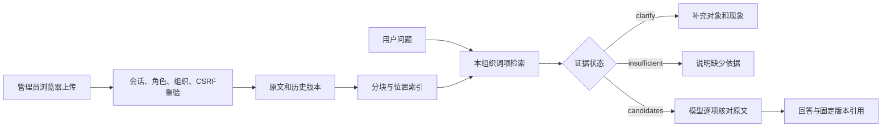

# 知识库开发与验收

本阶段将写死的短文档检索扩展为可导入、可追溯的组织知识库。它服务于客服排障与工单 Agent：回答可以指向当时实际使用的原文，资料不足时要求模型追问或承认未知。功能已接通，缺证策略仍属于实验版，不能把检索命中率称为 Agent 事实准确率。

## 本机使用

1. VS Code 打开根目录 `SupportAgent.code-workspace`，运行 `Support: Start`。
2. 打开 https://localhost:8443/console/knowledge ，普通员工可检索、查看原文。
3. 需要导入时，在服务台退出后用 `admin` 登录；密码只在本机 `.local/users.json` 查看。网页换账号不会改变聊天 Agent 固定的 alice 身份。
4. 选择 UTF-8 `.md` 或 `.txt`，填写标题和来源说明，点击“确认并导入”。最多 1 MiB、10000 行；不支持 PDF/DOCX/OCR，也不抓取来源 URL。
5. 同组织同名文件更新同一文档。当前内容、标题和来源相同时为幂等重放；发生变化生成新版本。若重新上传旧内容，它也是一次新版本，不是删除中间历史。
6. 打开文档，在“版本与原文摘要”查看历史，再从分块定位链接跳到原文行。原文的 Markdown/HTML 按纯文本显示。

业务演示优先使用 `data/documents/knowledge.md`：它将 `data/knowledge.json` 的 16 条客服知识逐条按原文转换成 Markdown 手册；不补写业务规则。16 篇独立文件在 `data/documents/articles/`，来源编号、原文摘要和合辑位置记录在 `manifest.json`。运行 `python scripts/export_knowledge.py` 可复现转换，原 JSON 保持不变。

合辑已通过管理员上传入口导入：`KD-8E45E617F1BC34DE98323D2A`，版本 1、7 个分块。正文与行号/偏移已核对；登录和 HTTP 429 问题可以检索到手册，缺失价格/税率返回证据不足。这是导入和检索功能验证，没有调用模型或修改旧评测分数。
https://localhost:8443/console/knowledge/KD-8E45E617F1BC34DE98323D2A?revision=1

合辑与原 16 条种子文档重复承载同一批事实，不算新增独立知识，正常库也可能出现重复候选。本轮只上传合辑，分篇文件供查看和以后选择使用；没有同时上传这 16 篇。原 JSON 继续用于冻结基线，不能将新库表现直接代入历史成绩。资料中模拟产品的 100MB/PDF 等政策，也不代表本机导入工具具备这些能力。

之前两版功能说明文档仅用于上传、分块和历史版本的工程验收，不作为业务内容效果的主要演示：`KD-13FD5B5BBDC8DB1F26B3265F`，v1 为 1866 字符、v2 为 1981 字符，各 4 块。页面：
https://localhost:8443/console/knowledge/KD-13FD5B5BBDC8DB1F26B3265F?revision=2

两份输入文件在 `data/samples/knowledge-demo-v1.md`、`knowledge-demo-v2.md`。演示脚本以相同文件名上传；手动上传不同文件名会得到不同文档。

可在 LibreChat 测试：“账号连续输错密码后锁定多久，请引用原文。”、“系统坏了怎么办？”、“请给出产品的正式认证编号。” 这些是演示输入，不保证每次生成完全相同答案。核对真实工具调用和原文；不要只看回答是否流畅。

## 设计与源码



- `app/knowledge.py`：新增 SQLite assets/revisions/chunks 表，保留旧 `knowledge_docs` 五列与种子数据。写入事务内再次检查管理员和有效会话。同组织规范化文件名唯一，导入摘要保证重复请求不增加版本。
- 分块按标题和段落边界、最多 600 字符、相邻 80 字符重叠。保留原文子串；起止 offset 为左闭右开，行号为从 1 开始的闭区间。CRLF/CR 规范成 LF，原文页面使用相同计数方式。
- 块编号绑定文档、版本和全文摘要。更新仅检索最新版，但旧版本证据链接保留。旧 16 篇种子资料为虚拟 v1，本轮文件被冻结；不要手工修改种子文件冒充持久化版本更新。需更新真实资料时走导入流程。
- `app/retrieval.py`：轻量 BM25、标题加权、中文双字词项、英文标识规范化、文档多样性。相关分数不是置信度。字面标识、部分事实类型、事件时间和模糊请求使用保守启发式判断，不能覆盖所有语义。
- `app/knowledge_ui.py`：组织目录、管理员上传、版本原文页面、`getSupportKnowledgeEvidence`。工具必须使用检索返回的真实 doc_id/chunk_id/revision；来源 URL 绑定固定版本。读取也重新核对账号与组织，版本参数限制 SQLite 整数范围。
- 整篇可疑指令/凭据检测在分块之前应用；命中后文档不进入候选，证据工具也不回显被隔离字段。检测不是完备的提示注入防御。已授权人员可在原文页面看到转义后的资料并核对。
- `integration/bootstrap.py`：Agent 指令区分候选和答案依据；要求逐项核对、不把通常时间写成保证、不推断未提供的价格或官方渠道。模型无知识导入工具。工单审批与角色规则不变。

## 固定比较与真实边界

`evaluation/knowledge_baseline.py` 冻结旧检索；`knowledge_run.py` 保存题集/语料/源码摘要、逐题结果与源码 ZIP，拒绝覆盖旧输出或运行中变更。原 100 题 Agent 报告仍为原来的 95/100 自动严格规则通过，本阶段没有重跑它，也没有改分。

本轮先冻结 48 道合成题（开发 16、测试 32），在开发集上修正后只运行一次正式 V3.0 比较。发现新问法误拒后作 V3.1 通用格式修复，另由协作代理预先冻结 16 题留出；实现者运行前未见题干。这仍是代理编写的小型合成评测，不是外部独立盲测。原题随后仅作回归。

| 最新 V3.1 新留出集 | 原 BM25 | V3.1 |
| --- | ---: | ---: |
| 有答案 Hit@3 | 8/8 | 7/8 |
| 有答案宏平均 Recall@3 | 100% | 81.25% |
| 纯无答案缺证识别 | 0/4 | 1/4 |
| 模糊请求明确追问标签 | 0/2 | 0/2 |
| 预期证据处置匹配 | 8/16 | 10/16 |
| 返回来源位置可核对 | 无该输出 | 19/19 |

计算：Hit@3 是有答案题前 3 个结果至少命中一个标准文档的比例；Recall@3 先按题计算命中文档/标准文档数，再宏平均。缺证识别只统计纯无答案题返回 `insufficient` 的比例。处置匹配只比状态是否满足预设策略，不代表最终回答正确。旧 API 无证据状态，使用“非空结果视为 candidates”的代理，不能将它称为旧模型幻觉。

已有 88 题回归：开发 16/16、原测试 21/32、旧 40 为 38/40 处置匹配；这些不能与新 16 题合并作为独立成功率。旧 40 题 Hit@3 仍 100%、Recall@3 98.61%、无答案缺证 2/4。正式 V3.0 失配报告和 V3.1 全部结果均保留。

V3.1 新留出剩余问题包括：`HTTP-429` 连字符格式误拒、加密扫描 PDF 的多文档召回不全、企业额度/队列算法/数据驻留未被检索层拦截、模糊问法未产生明确追问状态。后续修复须作为新版本，已见题只作回归。返回 candidates 的最终答案是否合理，要另看实际模型对证据的核对，不能由这个标签推断它已经编造。

同一新 16 题各重复 3 次，进程内 CPU P50/P95 从 0.8442/1.3067 ms 变为 3.76965/6.1229 ms。候选耗时包含分块，不含 HTTP、数据库、身份验证和模型；不能宣称线上响应只要几毫秒。种子文档较短，来源位置指标没有覆盖大型真实资料库；两版 4 块文档通过另行 HTTP 演示验证。

## 复现

VS Code 任务 `Support: Knowledge comparison (no model)` 生成原 48+40 题回归，新目录位于 `.local/knowledge-evaluation/<UTC>/`。不调用模型、不改业务库。运行器也支持 `--cases evaluation/knowledge_holdout_v31.json`；必须先用同一题集生成 baseline，再给 candidate 传 `--baseline-report`，不同题集不能混用。

```powershell
cd E:\LibreChat\extensions\support-agent
E:\LibreChat\.venv\Scripts\python.exe -m pytest tests/test_knowledge.py tests/test_knowledge_console.py tests/test_retrieval.py tests/test_knowledge_evaluation.py -q
```

以上 V3.1 历史实验尚未包含向量检索和重排，不能据此判断其收益。后续已按用户要求加入本地向量混合检索与 cross-encoder 重排，另行冻结业务题集比较证据覆盖、排序、时延和内存。新功能、独立评测口径与使用方法见 [HYBRID.md](HYBRID.md)；本页历史分数不变。

## 缺证、追问与资料扩充的后续版本

V4.1 在三种模式后增加逐项证据检查和部分可答提示，详见 [EVIDENCE.md](EVIDENCE.md)。新增 `data/documents/support-supplement.md` 为 16 篇项目自编模拟业务规范，经真实管理员入口导入为版本 1、17 块；独立业务知识合计 32 条。原知识 JSON、转换 MD 与历史报告未改。首次新 16 条的规则符合从 8/16 到 12/16；规则处置不是生成答案正确率，当前仍需模型逐项核对实际原文。
