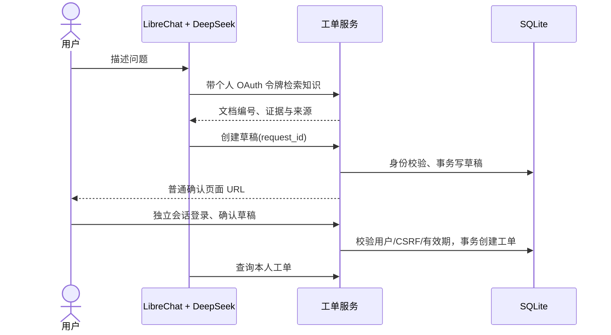

# 企业工单 Agent 实验项目

基于 LibreChat 的独立业务扩展：DeepSeek 负责理解与工具选择，Python 服务负责知识检索、工单草稿、权限验证和人工提交。工单业务及原知识库使用演示样本；新增公开资料评测使用 IBM Cloud 产品文档与人工编写的 MTRAG 对话，独立存放，不是企业内部工单或生产咨询记录。

## 阶段四：多人使用与运行维护（2026-11-10）

正常服务现使用个人 OAuth 连接：每个 LibreChat 账号独立授权一个服务台账号，同一 Agent 按实际业务身份执行工具。服务台角色不等于 LibreChat 平台管理员；聊天中声明身份不会改变权限。这是两个账号体系之间的显式连接，尚未接企业统一身份提供方或 SSO。

- LibreChat：http://localhost:3080；服务台：https://localhost:8443/console。旧 8090 工作台入口会跳转到 HTTPS。
- LibreChat 本机演示账号保存在 `.local/librechat-users.json`，服务台账号密码在 `.local/users.json`；都不得提交 Git。已有 demo 账号继续可用。
- 首次调用工具时点击 LibreChat 的连接入口，在 HTTPS 页面登录自己的业务账号，核对姓名后确认连接。员工、客服、管理员均使用同一个 Agent，返回范围由后端检查。
- 当前业务服务拒绝旧固定 API Key。OAuth 访问令牌有效 5 分钟，刷新令牌最长 7 天；撤销、停用、角色或组织变化在服务端立即失效。工单正式写入仍须本人独立确认。
- `/console/oauth/connections` 可查看和撤销本人授权。退出／切换服务台账号会撤销本次会话的授权，不影响其他设备独立授权。LibreChat 对旧令牌的缓存最多需 5 分钟过期后才重新弹出连接，期间拒绝请求，不会继续获得旧权限。
- 默认启动没有调试器或热重载；VS Code 使用 `Support: OperationsStart (OAuth + TLS, no model calls)`，改代码后重启。需要断点时显式用 `Support: StartDebug`，再 F5。
- `Support: Backup` 保存 SQLite、MongoDB 和 LibreChat 持久化文件，并生成哈希清单；隔离恢复演练、停写备份和配置恢复边界见 [运行维护说明](ops/README.md)。
- `Support: Monitor` 检查健康、就绪、HTTP 工具结果、延迟、备份年龄及容器状态；监控密钥与业务凭证隔离。监控的 HTTP 成功率不是 Agent 回答准确率。
- `.github/workflows/support-agent.yml` 提供离线自动检查；推送到 GitHub 后才能产生远端 CI 记录。本机测试记录与模型评测分别保存。

本机 HTTPS 使用仅当前 Windows 用户信任的专用服务器证书，私钥在 `.local/support-tls`，180 天有效。部署到其他主机应换成该主机真实域名的可信 HTTPS 证书，并更新 OAuth 精确回调与来源配置。当前端口仍绑定 127.0.0.1；这次完成本机可复现部署，不代表已发布公网服务。

本次观察到内置浏览器仍拒绝本地证书，而 Windows、Node 和 Python 的严格 TLS 验证通过。请通过 VS Code 的 `Support: OpenApps` 在本机系统浏览器打开应用，并在同一浏览器完成 LibreChat 登录、业务账号授权和回调；不要只把授权链接复制到另一个浏览器，因为回调绑定原登录会话。未声称内置浏览器或 Edge 的视觉验收已通过。

外部工单平台暂未接入。当前自建工单流程可完整运行；待明确 Jira、禅道等目标、字段及同步规则后再实现，避免提前增加不需要的集成。

## 阶段一：工单处理与角色权限

状态流程为 `open → in_progress → resolved → closed`（待处理、处理中、已解决、已关闭）。分配负责人和添加记录不会改变状态，但每次实际修改都会增加 `version`，并保留操作人、说明、前后状态和时间。已关闭工单不能再修改，本阶段没有重开功能。

| 角色 | 可见范围 | 可执行操作 |
| --- | --- | --- |
| 员工 requester | 本组织内自己提交的工单 | 补充记录；已解决后确认关闭 |
| 客服 support | 本组织内本人提交或分配给自己的工单 | 负责工单的开始处理、记录进度、标记解决；本人提交的工单仍可确认关闭 |
| 管理员 admin | 本组织工单 | 分配给本组织启用的客服；开始处理、记录进度、标记解决；关闭仍需提交人 |

本地演示账号：`alice`、`bob` 为员工，`support1`、`support2` 为客服，`admin` 为管理员。密码只在 `.local/users.json` 查看。初始化只补缺失账号，不覆盖既有账号的凭证或角色；原账号未声明 role 时默认为 requester。账号角色由本机配置管理，聊天内容和工具参数不能修改角色。

### 如何演示完整流程

1. 在 LibreChat 请 Agent 创建一张明确标记“演示”的故障工单草稿，用 alice 登录确认页面并创建。
2. 在工作台退出 alice，使用 admin 登录，打开工单详情，选择“分配负责人”，选择 support1，填写原因，再预览、确认。
3. 退出后用 support1 登录，对该工单依次“开始处理”“添加处理记录”“标记已解决”。每次都填写说明并确认。
4. 回到使用 alice 业务账号授权的 LibreChat 用户，查询工单与历史，并请 Agent 基于最新版本准备关闭提案。客服或管理员操作应使用分别授权了对应业务账号的 LibreChat 用户。
5. 用 alice 登录提案确认链接，核对后关闭。工单时间线记录完整过程；重复确认不会重复写入。

Agent 的新增工具：`listAssignableSupportStaff`、`getTicketHistory`、`proposeTicketUpdate`、`getTicketUpdate`，加上原有 7 个，共 11 个。任何写操作都只能生成待确认草稿/提案，正式写入接口不进入 OpenAPI 工具列表。

### 设计与修改入口

- `app/lifecycle.py`：角色与资源权限、状态转换、提案幂等、确认时重新校验、版本冲突控制。
- `app/workbench.py`：工单详情、时间线、按权限展示的操作表单、变更确认页、新工具接口。
- `app/db.py`：保留已有数据的 SQLite 迁移，角色、组织快照、负责人、版本、提案与处理事件。
- `tests/test_lifecycle_api.py`：HTTP 层完整流程与越权、重试、过期、并发等验收。

每个提案绑定操作人和 `expected_version`，有效期沿用 `SUPPORT_DRAFT_TTL_SECONDS`（默认 30 分钟）。确认需独立浏览器会话及 CSRF 校验；事务内重新读取角色、组织、当前负责人和工单版本。角色已撤销、负责人变更或工单版本过旧时，不能沿用旧提案执行。相同 request_id 的相同内容可重试，不同内容返回冲突；成功操作和历史记录一起提交。

升级会保留旧工单、草稿和审计；旧 pending 工单归入待处理，旧记录增加明确标注的迁移基线，不伪造历史处理动作。数据库在 Docker 数据卷中，停止服务保留数据。本机升级前备份位于工单容器的 `/data/backups`。

## 阶段二：真实 Agent 评测基线

`evaluation/agent.py` 通过真实 LibreChat Agent 会话调用 DeepSeek，并同时检查回答、实际工具调用和 SQLite 最终状态。正式集固定 100 条合成任务（8 类、其中 10 条为两轮任务），另有 12 条开发任务。它不是生产日志或独立盲测；自动规则通过率与人工语义准确率分别处理，费用为根据返回 token 和价格表计算的估算值。

评测使用独立账号、7 个固定身份 Agent（覆盖 3 类角色）和 `support-eval` 容器（本机 8091），数据库卷与正常演示分离。每题初始化模拟数据，模型只能创建草稿或变更提案；夹具中的初始工单状态不算模型执行成果。该设计检验模型是否尊重角色、状态与确认边界，实际浏览器确认流程由阶段一服务测试与演示验证。

在 VS Code 的“终端 → 运行任务”中依次运行：

1. `Support: Prepare isolated evaluation`：启动并准备评测环境，不调用模型。
2. `Support: Agent smoke (3 paid tasks)`：3 条开发集真实任务，估算费用停止阈值 0.5 元。
3. `Support: Agent baseline (100 paid tasks)`：100 条冻结任务，单并发，估算费用停止阈值 5 元。
4. `Support: Stop evaluation service`：结束评测后释放额外容器内存，保留报告和数据卷。

每次报告位于 `.local/evaluation/results/<run_id>/report.html` 与 `report.json`，最近一次路径记录在 `.local/evaluation/latest.json`。运行期间每题保存回答、工具输入输出、前后数据库快照、用量和判断；失败不自动重试，不从分母中删除。冻结语料/代码/参数，恢复时校验一致，独占锁阻止并行重置评测库。费用阈值不是供应商硬限额，当前正在执行的任务可能超出；未知用量、异常或来源变化会停止。

详细统计口径、恢复命令和旧检索评测区别见 [evaluation/README.md](evaluation/README.md)，题集说明见 [evaluation/CASES.md](evaluation/CASES.md)，实际测量记录见 [VALIDATION.md](VALIDATION.md)。

### 后续顺序

阶段二的复核与修正说明见 [evaluation/REVIEW.md](evaluation/REVIEW.md)。新增工具对象类型校验、同源权限说明和不可信文本隔离；逐题参考要求保存在 `evaluation/reference_answers_v2.json`。旧 100 题成绩不覆盖；32 题针对性回归通过 VS Code 的 `Support: Agent repair regression (32 paid tasks)` 运行。本轮人工只需复核15项：原95/100中5条自动失败，加10条关键权限代表（合计12道原题、3道新增变体）。额外辅助问题和其余原题可选查看。定向工作台由 `evaluation/targeted_review.py` 生成，选定项默认待审，进度按15项计算；人工决定只能导入独立记录，用户确认权限标准不等于具体答案已经验收。

阶段三已增加知识导入、分块、版本来源定位与缺证提示，使用方法与真实质量边界见 [KNOWLEDGE.md](KNOWLEDGE.md)。阶段四现已加入个人 OAuth 授权、自动检查、备份和监控，见本文开头。历史评测的固定身份配置保持独立，不用新身份模式改写旧成绩。

缺证与追问现已更新到 V4.1：逐项返回已知依据、缺项与澄清问题，保留部分可答内容，并扩充 16 篇模拟业务资料。首次新 16 条小型留出严格规则符合 12/16，仍有数量主体错绑、追问与过度拒答边界，不能称生产准确率。使用、复现和完整口径见 [EVIDENCE.md](EVIDENCE.md)；历史 100 条 Agent 95/100 不变。

## 阶段三：可追溯知识库

打开 https://localhost:8443/console/knowledge 。员工可阅读本组织文档，管理员可上传 UTF-8 `.md` / `.txt`（最多 1 MiB、10000 行）。相同组织和文件名使用同一文档；与当前内容及元数据相同的重试不增版本，有变化时保留旧版。业务演示资料为 `data/documents/knowledge.md`，由原 `knowledge.json` 的 16 条客服知识逐条转换，已导入为版本 1、7 个分块；分篇 MD 和来源清单在同目录。转换不新增业务事实，原种子与合辑会有重复候选。此前 `data/samples/` 的功能说明只用于工程流程测试，详见 [KNOWLEDGE.md](KNOWLEDGE.md)。

新增 `getSupportKnowledgeEvidence` 只读工具，当前共 **12 个工具**；知识导入不进入 Agent 工具列表。检索返回精确原文分块、文档/版本/块编号、字符偏移、行号和原文链接。`candidates` 只表示相关；`clarify` 要求补充问题，`insufficient` 表示当前检索证据不足。模型仍须逐项核对事实，不能把相关段落当作完整答案。

VS Code 运行 `Support: Knowledge comparison (no model)` 可生成原 BM25 与当前词项实现的固定集对比，不调用 DeepSeek、不操作正常业务库。每次输出在 `.local/knowledge-evaluation/` 新目录。默认 48 题（开发 16、已公开测试 32）加旧 40 题，仅作后续回归；V3.1 另外预先冻结的 16 题留出结果独立报告，不合并成整体成功率。当前缺证与追问启发式仍有泛化不足。新增的本地向量融合及 cross-encoder 重排使用另一套固定比较，见 [HYBRID.md](HYBRID.md)，不覆盖这些历史结果。

## 从 VS Code 启动

1. 启动 Docker Desktop，打开仓库根目录的 `SupportAgent.code-workspace`。
2. 当前电脑已创建 `.venv`。首次换电脑先用 Python 3.12+ 执行 `py -3.12 -m venv .venv`，再在“终端 → 运行任务”执行 `Support: Setup`。任务直接运行 Python，无须更改 Windows 脚本执行策略。
3. 在根目录 `.env` 填写 `DEEPSEEK_API_KEY`，不要提交这个文件。
4. 执行 `Support: Start`。第一次会下载镜像；以后复用本地镜像和数据。
5. Start 会等待服务就绪并初始化本地演示账号、私有 Agent 和 Actions。单独重建工具时执行 `Support: Bootstrap demo agent`。初始化不调用付费模型。
6. 打开 http://localhost:3080 ，使用 `.local/demo.json` 的 email/password 登录。
7. 首次使用“企业客服工单 Agent”时完成个人 OAuth 连接：在 https://localhost:8443 登录你自己的服务台账号。演示账号映射和多人准备任务见本文阶段四。审批必须登录与草稿创建者相同的业务账号。

聊天服务、工单页面和调试端口均只发布到本机 `127.0.0.1`。不要公开演示账号或开启公网端口。

## 演示流程

先输入：

> 公司的 SSO 登录失败，显示回调地址不匹配。请先查帮助文档，给出排查步骤并引用文档编号。

再输入：

> 按文档操作仍然无法登录。请创建一张中优先级工单草稿，标题“SSO 登录失败待排查”，描述包含刚才的问题，给我确认链接。

Agent 应返回草稿及审批链接，此时没有正式工单。打开链接，用创建草稿时授权的同一业务账号登录，核对内容，点击“确认并创建工单”。回到聊天，让 Agent 查询工单。也可以取消草稿，或重复提交验证只有一张正式工单。

确认页只接受独立浏览器会话及 CSRF 校验；模型持有的 OAuth 工具令牌不能提交工单。没有 `approved=true` 绕过入口。

## 哪些是新增工作

| 范围 | 来源与边界 |
| --- | --- |
| 聊天界面、账号、Agent 循环、模型接入、Actions 执行 | 复用 LibreChat，不声称自行开发 |
| `app/` | 新增 FastAPI/SQLite 工单业务服务、数据验证、状态流转、确认控制台 |
| `app/search.py`、`app/retrieval.py`、`data/` | 保留历史 BM25；新增分块检索、标识格式归一化与缺证/追问提示，返回候选不承诺答案正确 |
| `app/knowledge.py`、`app/knowledge_ui.py` | 管理员文档导入、幂等更新、不可变历史版本、精确来源定位与只读证据工具 |
| 身份、幂等和审计 | 原生 Action OAuth 对接个人业务授权，服务端实时校验用户与scope；事务与唯一索引控制重试；事件记录 trace_id |
| `tests/`、`evaluation/` | 新增权限/并发/过期等测试、检索基线，以及真实 Agent 冻结题集、状态判分、用量与费用记录 |
| `integration/`、`deploy/`、`scripts/` | 新增 LibreChat 集成、部署配置、初始化与开发脚本 |

这是通过 LibreChat 官方 OpenAPI Actions 扩展的独立服务，没有修改其 TypeScript 核心。SQLite 适合本机演示和小规模单实例；本项目没有经过生产容量、可用性或合规验收。

## 架构与权限

工具 API 不接受模型指定 user_id。用户由服务端 OAuth 授权记录解析，越权读取统一返回 404。重复 request_id 的相同内容返回原草稿，不同内容返回 409；正式工单按 draft_id 唯一，重复确认返回同一结果。

当前同一 Agent 可私下共享给明确的 LibreChat 用户，每人分别连接服务台账号，令牌按 LibreChat userId + actionId 加密保存。服务台不信任未验签的 OAuth state 中的身份字段；实际用户由登录和显式授权决定。企业统一登录仍需后续对接真实 IdP。

## 在 VS Code 准备公开 IBM Cloud 评测

本节准备协议更新于 **2026-11-10**。后续正式生成与辅助语义评审已有独立报告，结果以该次冻结报告为准；本节介绍准备命令，不重复或改写评测分数。完整口径见 [PUBLIC_EVALUATION.md](evaluation/PUBLIC_EVALUATION.md)。

打开根目录的 `SupportAgent.code-workspace`，从“终端 → 运行任务”按第 1–6 步准备。日常重启只需第 4 步，已有的 Agent 检索模式会保留；第 7 步是不用公开检索时的可选收尾。

| VS Code 任务 | 用途 |
| --- | --- |
| `Public: 1 Prepare IBM Cloud data` | 下载固定版本文档、问题与许可，核验 SHA；生成固定的 8 条开发预检查名单 |
| `Public: 2 Prepare CPU retrieval models` | 准备英文检索与重排模型；已有文件通过验证后保留 manifest，避免使已建索引失效 |
| `Public: 3 Build full corpus index (resumable)` | 为完整 72,442 段构建词项和向量索引，4 个进程、每个 2 线程；再次运行从已保存进度恢复 |
| `Public: 4 Start public knowledge service` | 单独启动只读公开资料服务，然后重启 LibreChat API 使工具域名配置生效 |
| `Public: 5 Set up public Agents (no model calls)` | 创建或核验独立回答、评审 Agent；初始化默认 lexical，正式运行按开发集冻结为 rerank；日常重启沿用已保存模式 |
| `Public: 6 Agent dry run (8 dev tasks, no model calls)` | 检查固定开发任务、输入大小与上下文预算，不发送模型请求 |
| `Public: Stop public service (preserve indexes)` | 仅停止 `support-public`，保留索引、模型、运行缓存和业务数据 |

这些新增入口不运行付费生成，也不运行正式 UN 测试。第 3 步仅进行本机 CPU 推理，首次构建耗时较长；不要同时启动多个构建任务。真实 Agent 评测须另外显式指定运行参数及预算。

第 7 个任务调用 `StopPublic`，不删除任何数据或数据卷；不用时停止公开检索服务可释放其占用的内存，适合这台 16 GB 电脑，恢复时再执行第 4 步。

公开资料服务地址是 `http://localhost:8192`，容器内工具地址是 `http://support-public:8092`。原工单服务继续使用 `http://localhost:8090`。数据和索引位于 `.local/public-benchmark/mtrag/`，模型位于 `.local/models/public-retrieval/`，独立凭证和 Agent 状态位于 `.local/public-benchmark/config.json`、`agents.json`。启动任务仅在工具凭证缺失时生成，不轮换已有凭证，不重新设置 Agent 模式，也不重建其他服务。

`compose.public-evaluation.yml` 使用独立 Docker named volume `public-retrieval-cache` 保存运行时索引和模型副本。启动时从只读 `/sources` 挂载校验源文件与副本 SHA，再原子替换到 `/data`；已有副本只有哈希一致才复用。这样让 SQLite 随机读取发生在 Docker 本地卷内，避免直接跨 Windows 挂载读取。它只是同一份冻结语料的运行缓存，不混入或挂载正常工单业务库，不改变原文、片段顺序或现有业务成果。端口只绑定 `127.0.0.1:8192`。

第 4、5 步需要原 LibreChat 服务已启动；公开服务复用本项目已有的 CPU 检索镜像。保留下载的 Apache-2.0 `LICENSE`、数据许可声明与来源指纹。原始数据来自 [IBM MTRAG](https://github.com/IBM/mt-rag-benchmark)，冻结提交为 `e0970de1b1207c2a9506adf238e6e1a22037e38a`。完整文档库保留 **72,442 个片段**，使用英文 `bge-small-en-v1.5` 与 `mmarco-mMiniLMv2-L12-H384-v1` CPU 模型；具体版本和文件哈希以 manifest 为准。这是英文产品文档的历史快照，不是实时 IBM Cloud 知识或实际客户工单；不能把旧快照答案直接说成当前产品承诺。

### 公开数据的固定口径与选型

开发集为 205 条任务、26 段对话，其中 188 条有正相关性标注。固定相同检索题后，开发集 Macro Recall@5 分别为：**重排 40.89%、混合检索 35.75%、BM25 22.00%**。BM25 加入前三条用户历史的结果为 18.61%，因此正式离线检索固定 `lastturn`，选定模式为 **`rerank`**；正式三种方案仍全部报告，不从正式成绩中反选最优方案。

| 公开正式评测口径 | Agent 任务 | 检索任务 | 用途 |
| --- | ---: | ---: | --- |
| 官方完整集合 | 131 | 86 | 原始实验与全部结果保留作参照 |
| 排除与开发集完整输入精确重复后的集合 | 126 | 82 | 主要质量、泛化讨论与简历口径 |

审计发现 5 条完整 `messages` 输入 SHA 与开发集相同，包含 4 条可回答和 1 条无答案任务，其中 4 条属于检索题。不能称原 131 条全部是全新独立盲测；按固定 ID 从保存的逐题结果中去重，不重跑模型或只排除失败题。去重后类型为：可回答 77、无答案 35、部分可回答 5、信息不足 9。**输入精确去重不证明语义无重叠，也不证明未进入模型预训练数据。** 原工单 100 题的 95/100 属于不同测试集，不能与这里混用。

Agent 使用 `official_history_conditioned_last_turn`：把官方参考历史和当前问题放进单条用户 JSON 提示，只生成本次末轮，不是自由运行多轮，也不是重新执行之前全部对话。参考答案、标签和参考证据只在独立 judge 阶段加入，不进入正式 `full_rag` 回答 Agent。检索命中、执行完成、证据支持和语义通过分别报告；无答案标签只针对原参考片段，完整检索得到有效新证据时可以回答并单独复核。

### 调用限制、超时与费用

回答和评审使用独立 provider 别名 `DeepSeekPublicEval`，仍调用同一 DeepSeek API/模型，隔离 SDK `maxRetries=0` 和关闭 thinking 的设置。回答 Agent 只持有两个公开资料只读工具；judge 没有工具或 Actions，不与正常业务 Agent 混用会话或工具凭证。

| 角色 | 最大输出 token | 上下文准入上限 | recursion limit |
| --- | ---: | ---: | ---: |
| answer | 1,000 | 32,768 | 5 |
| judge | 2,200 | 131,072 | 2 |

默认串行，显式参数可选择最多 3 并发；每条任务使用独立会话与客户端，预算仍由同一个独占账本预留。一次生成只提交一次 POST；SSE 使用同一 GET 连接，每次读取根据剩余总 deadline 设置超时，心跳不延长总时限。连接或读取失败不会自动重发付费 POST。

旧 dev8 judge 在 3 次 SSE 超时后安全停机，原始报告与 attempt ID 保留；后续费用审计与正式运行已有独立记录。未知 token 的保守费用占用不能说成 provider 实测 token、实际账单或零费用。核账和正式结果以对应报告为准，不覆盖旧失败报告。

同一 DeepSeek 模型生成和评审可能有相关错误、自我偏好；LLM 辅助评分不是人工准确率。报告保留未评和不确定任务的计划分母，安排失败项与固定随机通过样本复核，不要求用户重新人工审核全部题目。

## 在 VS Code 二次开发

正常业务使用四个轻量服务：LibreChat、MongoDB、工单服务、HTTPS 入口。Python 代码只读挂载进容器，默认需要重启生效；显式 StartDebug 才开启热重载。数据库保存在 Docker 卷中。修改平台配置后重跑 Start。

LibreChat 平台使用固定摘要的上游镜像，具体摘要在 `deploy/LibreChat.Dockerfile`。当前修改与热重载针对自己的 Python 业务扩展；修改上游 React/TypeScript 源码需要另行安装 Node 开发依赖并构建平台，Start 不会编译仓库中的整套平台源码。

- 改工具或审批逻辑：`app/main.py`、`app/db.py`、`app/security.py`。
- 改检索：`app/retrieval.py` 保留公共证据规则；`app/hybrid.py` 实现可选向量缓存、RRF 融合与重排，`app/hybrid_models.py` 实现本地 CPU ONNX 推理。`app/search.py` 保留历史基线。启动与评测见 [HYBRID.md](HYBRID.md)。
- 改知识文档：`data/knowledge.json`，重启工单服务使知识库重新载入。
- 打断点：选择 `Support Agent: attach to running Docker service`，按 F5；Python 与调试扩展已安装。
- 测试：运行 `Support: Test`。
- 检索评测：运行 `Support: Evaluate`，报告生成在 `evaluation/results/`，不调用模型。
- 真实 Agent 评测：运行上面的 Prepare / Agent smoke / Agent baseline 任务；结果在 `.local/evaluation/results/`。
- 停止：运行 `Support: Stop`，保留数据库。不要执行删除卷或清库命令来“重置”正常工作。

建议亲自逐步演示“分配 → 开始处理 → 记录 → 解决 → 关闭”，再阅读真实评测报告中的失败回答、工具轨迹和数据库状态，区分模型决策问题、检索缺陷与判分规则的局限。

## 如何量化与写简历

报告分别记录：服务用例通过数、8 并发请求下重复工单数、固定题集 Hit@3/Recall@3/MRR、进程内测试请求 P50/P95。检索指标只代表这个小型演示题集，不能外推为真实企业准确率；进程内耗时不是端到端 Agent 延迟。

新增的真实 Agent 报告单独记录模型、题集和代码哈希、可观测模型调用轮次、工具调用、引用、最终状态、任务耗时与 token/费用；接口及行为约束与关键词检查分列，人工语义复核保持待办。少量冒烟只能说明链路可用；100 条合成测试也不能写成“生产准确率”或虚构节约人力。

简历可围绕 STAR 写：为企业支持场景构建可审计的工单 Agent；基于 LibreChat 集成 DeepSeek，自行实现知识检索与工单服务，采用独立人工确认、用户级鉴权、事务幂等和审计；结果填写本次可复现报告中的真实数字，并明确是本机实验结果。部署、理解、修改与验证完成后再把它列为自己的项目经历。

## 排错

- 页面打不开：Docker Desktop 是否运行；查看 `docker compose -f compose.support.yml ps`。
- DeepSeek 返回认证/额度问题：检查本机 Key 和服务余额；改 `.env` 后重跑 Start。不要把 Key 截图或粘贴到聊天。
- Agent 找不到工具：重跑 Bootstrap，确认运行的是工单助手，不是普通 DeepSeek 对话。
- 工单工具 401：检查是否已用自己的账号完成 OAuth 连接、授权是否撤销或过期。不要把旧 API Key 填回共享 Action；配置变更后重启服务，等待旧令牌缓存过期并重新连接。
- 电脑卡顿：三个服务内存上限合计约 2.9 GiB，Docker/Windows 还有额外占用。当前机器可用内存很少，需要结束你不再使用的应用；本方案不会加载本地大模型。

上游：[LibreChat](https://github.com/LibreChat-AI/LibreChat)。模型配置依据：[DeepSeek Tool Calls](https://api-docs.deepseek.com/guides/tool_calls/)。项目保留原开源许可证。

## 独立追加实验：检索优化与目标任务成功率（2026-11-12）

本节新增实测口径，保留上面的历史 95/100 严格规则成绩和原公开资料报告。两条路线分别评价检索相关性与工单任务目标，不能混为完整 RAG 回答准确率，也不能推算真实企业收益。

### 固定 82 条公开文档检索回归

检索完整 IBM Cloud **72,442 段**语料，使用原有 **82 条已见回归查询、同一 gold 标注、k=5**。先在 188 条开发查询上比较 57 个排序配置，再冻结一个配置运行 82 条。开发 train/validation 为 171/17 条、23/3 段会话；这不是新的独立盲测。

| 方案 | Macro Recall@5 | Hit@5 | MRR@5 | 完整检索 P50 / P95（秒） |
| --- | ---: | ---: | ---: | ---: |
| 历史 BM25 | 32.25% | 46.34% | 36.46% | 0.162 / 0.321 |
| 历史 BM25 + 向量 | 42.25% | 64.63% | 46.36% | 0.179 / 0.410 |
| 历史混合检索 + 重排 | 45.69% | 63.41% | 50.73% | 3.578 / 4.055 |
| 本轮冻结二次 RRF | **46.56%** | **64.63%** | **53.68%** | **3.681 / 4.568** |

本轮保留每路 20 候选、融合后 10 段重排，再按重排名次 75% / 初始检索名次 25% 做二次 RRF（k=10）。相对已有重排仅 **+0.88 个百分点**：2 条改善、2 条下降、78 条不变；探索性配对 95% 区间为 **[-0.95, +3.76] 个百分点**，包含 0，不能宣称显著或稳定泛化提升。相对早期 BM25 的累计差异为 +14.32 个百分点，不能全部归因于本轮增量。历史与新增延迟来自不同运行时点，不是严格等负载速度对照。

扩大候选、简单加入历史等失败方向保留。候选召回上限不是最终 top5 成绩；开发阶段缓存候选后的重排时间不是完整检索延迟。本轮新增流程属于**评测实现，未替换当前本地服务默认检索配置**。

### 工单 Agent 目标任务成功率

复用 100 条自建合成历史回归任务，覆盖 8 类场景，固定分母 100；真实调用当前 12 工具 Agent，以目标、数据库最终状态、安全约束和回答依据联合验收。语义部分为同款 DeepSeek 模型辅助评审，非官方 τ-bench 成绩或 100 条人工验收。写操作合格终点为 pending 草稿／提案与正确的本人独立确认交接，不把正式审批或预置状态算作 Agent 自主完成。

| 口径 | 成功 | 失败 | 未评分 | 确认 TSR |
| --- | ---: | ---: | ---: | ---: |
| 原始严格 JSON 判分 | 89 | 3 | 8 | 89% |
| 独立零调用格式规范化审计后 | **96** | **3** | **1** | **96%（96/100）** |

实际尝试 100 条，完整执行 **99 条**；计划/发送 110 次用户消息，完整完成 **109 次**。P05 在原 5 元请求级预算处中断，保留未评分，未重跑、不当业务失败、不从 100 分母删除。原运行判定、行政归类和预算快照均保留。其他失败为 K08/K09 未找到有标准依据的知识、P04 过度隔离导致没有概括正常业务故障。

语义结构规范化仅移动既有 reasons 字段或补唯一缺失的根闭合括号；8 条格式修复中 7 条从未评分变为成功，K08 仍失败。四维标签、理由、证据均不改，0 次额外模型调用。前序来源表达解析修复和 38 条统一重评也保留旧判定；**评分器修复不等于 Agent 能力提升**。

99 条完整任务 P50/P95 为 **6.422/11.500 秒**；89 条单消息任务为 6.250/9.047 秒，10 条双消息任务为 11.094/12.484 秒。含模型、工具及最终数据库取证，不含夹具重置、模型评审和人工确认等待；与旧 22.594 秒不能直接推出受控加速收益。

所有调用通过专用请求级预算代理：先预留、再按 usage 结算；缺用量时阻止后续调用。原 5 元在保守占用 4.946338 元时硬停，用户仅为未尝试的 P06–P10 追加最多 0.50 元，累计上限 **5.50 元**。最终 **393 次请求全部结算，保守估算 5.164702 元**（Agent 3.201624 + 全部评审 1.963078，含旧无效评审、诊断及统一重评），不是供应商实际账单。

### 源码与可复核产物

- 检索诊断／开发／回归入口：`evaluation/retrieval_v2.py`、`evaluation/retrieval_v2_regression.py`，另有工作区 `work/retrieval-v2/` 的开发比较与选择脚本。
- TSR：`evaluation/task_success_setup.py`、`task_success_run.py`、`task_success.py`、`task_success_proxy.py`、`task_success_report.py`；冻结目标为 `task_success_references.json`。
- 最终 TSR 原始证据：仓库根 `.local/task-success-v1/results/20261112T100808Z-continue-337462/`；唯一预算账本 `.local/task-success-v1/budget.json`。
- 交付目录：`E:\codex\2026-11-08\agent-github-agent-staffar\outputs\` 中 `LibreChat-任务成功率评测.html/json` 与 `LibreChat-检索优化与任务成功率.html/json`。逐题问题、回答、工具调用、目标、数据库变化及原／新判断均可展开查看。
- 同一工作区 `outputs/retrieval-v2/dev/` 保留 57 方案和 `selection-v2-complete.json`；`outputs/retrieval-v2/regression-20261112-v2/` 为固定 82 条最终观测；`work/agent-benchmark-v1/judge-format-audit-final.json` 为独立格式审计。
- 离线刷新原始报告：在扩展目录运行 `python -m evaluation.task_success_report`。综合报告生成器在工作区 `work/retrieval-v2/build_combined_report.py --generate`，校验完整来源与固定分母后生成；两者不调用模型。
